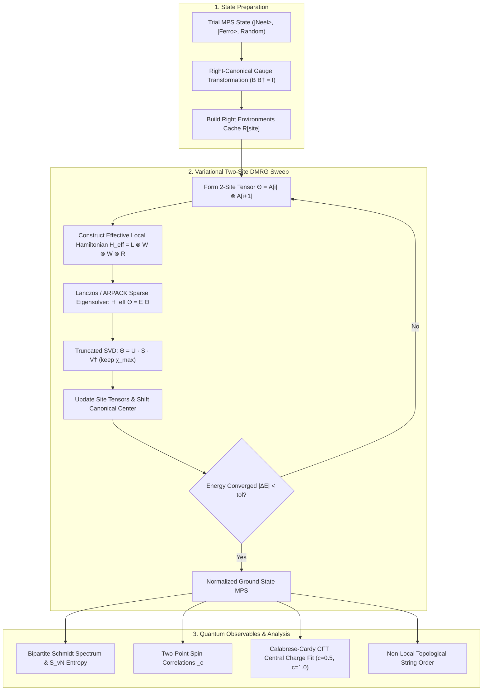

# EntangleTensor

[](https://github.com/ZengLLQ/entangle-tensor/actions/workflows/ci.yml)
[](https://www.python.org/)
[](LICENSE)
[](https://github.com/astral-sh/ruff)
[](https://mypy-lang.org/)

**EntangleTensor** is a high-performance Python simulation engine for one-dimensional quantum many-body systems powered by **Matrix Product States (MPS)**, **Matrix Product Operators (MPO)**, the **Density Matrix Renormalization Group (DMRG)**, and **Time-Evolving Block Decimation (TEBD)**.

Designed for condensed matter physics and quantum information science, EntangleTensor bypasses the exponential scaling of Hilbert space ($d^L$) to simulate strongly correlated spin chains, quantum critical phase transitions, non-equilibrium quantum quench dynamics, and topological order with machine-precision accuracy.

---

## Key Features

- **Matrix Product State (MPS) Engine:**
  - Open boundary condition 1D MPS representation with flexible virtual bond dimensions.
  - Gauge fixing via QR and singular value decomposition (SVD) into left-orthogonal ($A^\dagger A = I$), right-orthogonal ($B B^\dagger = I$), and mixed-canonical forms.
  - Truncated singular value compression controlling maximum bond dimension $\chi$ and tracking discarded truncation error $\sum_{k > \chi} s_k^2$.
  - Exact inner products $\langle \phi | \psi \rangle$ and L2 state normalization.

- **Matrix Product Operator (MPO) Architectures:**
  - Standard finite-state machine (FSM) representations of 1D quantum spin chains:
    - **Transverse-Field Ising Model (TFIM):** $H = -J \sum \sigma^z_i \sigma^z_{i+1} - h \sum \sigma^x_i$ ($w=3$).
    - **Spin-1/2 Heisenberg $XXZ$ & $XXX$ Chains:** $H = \sum [ \frac{J}{2}(S^+_i S^-_{i+1} + S^-_i S^+_{i+1}) + J_z S^z_i S^z_{i+1} ] - h_z \sum S^z_i$ ($w=5$).
    - **Spin-1 Haldane Chain:** $H = J \sum \vec{S}_i \cdot \vec{S}_{i+1} + D \sum (S^z_i)^2$ ($w=5$).
  - Fast tensor sandwich contractions $\langle \psi | H | \psi \rangle$ scaling as $\mathcal{O}(L D^3 w d)$.

- **Two-Site Variational DMRG Solver:**
  - Iterative variational ground state optimization dynamically expanding bond dimensions $\chi$.
  - Efficient effective local Hamiltonian projections $H_{\text{eff}} = L^{[i-1]} \otimes W^{[i]} \otimes W^{[i+1]} \otimes R^{[i+2]}$ evaluated via Level 3 BLAS tensor contractions.
  - Sparse Lanczos / ARPACK eigensolvers (`scipy.sparse.linalg.eigsh`) with warm-start vectors and power iteration fallbacks.
  - Monotonic energy convergence tracking and truncation error diagnostics.

- **Real & Imaginary Time TEBD:**
  - Second-order Trotter-Suzuki decomposition:
    $$U(\Delta t) = e^{-\frac{\Delta t}{2} H_{\text{even}}} e^{-\Delta t H_{\text{odd}}} e^{-\frac{\Delta t}{2} H_{\text{even}}} + \mathcal{O}(\Delta t^3)$$
  - Imaginary-time cooling ($\Delta\tau \in \mathbb{R}^+$) for independent ground state verification.
  - Unitary real-time dynamics ($\Delta t \in \mathbb{R}$) simulating quantum quench experiments and entanglement light cones.

- **Entanglement & Topological Diagnostics:**
  - Full bipartite Schmidt decomposition spectrum $\{\lambda_k\}$ across all lattice cuts.
  - Von Neumann entanglement entropy $S_{\text{vN}} = -\sum \lambda_k^2 \ln \lambda_k^2$ and Rényi entropies $S_\alpha$.
  - Conformal Field Theory (CFT) central charge $c$ extraction using the Calabrese-Cardy formula:
    $$S(x, L) = \frac{c}{6} \ln\left[ \frac{2L}{\pi} \sin\left(\frac{\pi x}{L}\right) \right] + s_0$$
  - Non-local topological string order parameter for Haldane phase detection:
    $$\mathcal{O}_{\text{string}}(i, j) = - \left\langle S^z_i \exp\left(i \pi \sum_{k=i+1}^{j-1} S^z_k\right) S^z_j \right\rangle$$

---

## Architecture & Tensor Contraction Flow



---

## Theoretical Overview

### 1. Matrix Product State (MPS) Representation

In an open quantum chain of $L$ sites with physical dimension $d$ (where $d=2$ for spin-$1/2$ and $d=3$ for spin-$1$), any state vector $|\psi\rangle \in \mathcal{H}^{\otimes L}$ is decomposed into:

$$|\psi\rangle = \sum_{s_1, \dots, s_L = 1}^d A^{[1] s_1} A^{[2] s_2} \cdots A^{[L] s_L} |s_1 s_2 \cdots s_L\rangle$$

where each $A^{[i]}$ is a 3-leg tensor of dimensions $(D_{i-1}, d, D_i)$, with boundary conditions $D_0 = D_L = 1$. The maximum internal bond dimension $\chi = \max_i D_i$ bounds the maximum bipartite entanglement entropy $S \le \ln \chi$ according to the area law for 1D gapped quantum systems.

### 2. Gauge Fixing & Canonical Forms

Due to gauge freedom $A^{[i]} \to A^{[i]} G_i$ and $A^{[i+1]} \to G_i^{-1} A^{[i+1]}$, we bring the MPS into **mixed-canonical form** centered at site $k$:

$$|\psi\rangle = A^{[1]} A^{[2]} \cdots A^{[k-1]} M^{[k]} B^{[k+1]} \cdots B^{[L]}$$

where:
- Sites $i < k$ are **left-orthogonal**: $\sum_s (A^{[i] s})^\dagger A^{[i] s} = I$
- Sites $i > k$ are **right-orthogonal**: $\sum_s B^{[i] s} (B^{[i] s})^\dagger = I$
- The norm $\langle \psi | \psi \rangle = \text{Tr}(M^{[k] \dagger} M^{[k]})$ and local expectation values depend solely on the center tensor $M^{[k]}$.

### 3. Effective Local Hamiltonian in DMRG

In two-site DMRG, the global eigenvalue equation $H |\psi\rangle = E |\psi\rangle$ projects onto the two-site subspace $\Theta_{s_i, s_{i+1}}$ at bonds $(i, i+1)$:

$$H_{\text{eff}} \Theta = \left( L^{[i-1]} \otimes W^{[i]} \otimes W^{[i+1]} \otimes R^{[i+2]} \right) \Theta$$

EntangleTensor evaluates $H_{\text{eff}} \Theta$ without forming the full tensor product matrix, achieving optimal $\mathcal{O}(D^3 d^2 w + D^2 d^3 w^2)$ scaling per step.

---

## Installation

Ensure you have Python 3.10 or newer:

```bash
git clone https://github.com/ZengLLQ/entangle-tensor.git
cd entangle-tensor

# Install with development dependencies
pip install -e ".[dev]"
```

---

## Quickstart

### 1. Ground State of the Heisenberg Antiferromagnet

```python
from entangle_tensor import (
    MatrixProductOperator,
    MatrixProductState,
    DMRGSolver,
    DMRGConfig,
    compute_entanglement_profile,
    connected_two_site_correlation,
    spin_half_operators,
)

# 1. Initialize a 20-site Heisenberg XXX chain
L = 20
mpo = MatrixProductOperator.heisenberg_xxz(L=L, J=1.0, Jz=1.0)
mps = MatrixProductState.neel_state(L=L, d=2)

# 2. Run two-site DMRG optimization
config = DMRGConfig(max_sweeps=8, chi_max=32, energy_tol=1e-9, verbose=True)
result = DMRGSolver(config).run(mps, mpo)

print(f"Ground State Energy: {result.ground_state_energy:.8f}")
print(f"Energy per site:     {result.energy_per_site:.8f}")

# 3. Compute Bipartite Entanglement Entropy
profile = compute_entanglement_profile(mps)
print(f"Mid-chain S_vN:      {profile.von_neumann_entropy[L // 2 - 1]:.6f}")

# 4. Measure Two-Point Spin Correlations
sz = spin_half_operators()["Sz"]
corr = connected_two_site_correlation(mps, sz, sz, site_i=10, site_j=11)
print(f"<Sz(10) Sz(11)>_c:   {corr.real:+.6f}")
```

### 2. Real-Time Quantum Quench (TEBD)

```python
from entangle_tensor import (
    MatrixProductState,
    TEBDSimulator,
    TEBDConfig,
    EvolutionType,
    compute_entanglement_profile,
)
import numpy as np

# Prepare initial product state |+ + ... +> polarized in +x
L = 12
plus = np.ones((1, 2, 1), dtype=complex) / np.sqrt(2.0)
mps = MatrixProductState([plus.copy() for _ in range(L)])

# Quench into ferromagnetic regime: J=1.0, h=0.2
bonds = TEBDSimulator.ising_bond_hamiltonians(L=L, J=1.0, h=0.2)
tebd = TEBDSimulator(mps, TEBDConfig(dt=0.02, total_steps=40, chi_max=32))


# Evolve unitarily in real time
def on_step(step, t):
    if step % 10 == 0:
        prof = compute_entanglement_profile(mps)
        print(f"t={t:.2f} s, Mid-cut S_vN: {prof.von_neumann_entropy[L // 2 - 1]:.4f}")


tebd.evolve(bonds, mode=EvolutionType.REAL, callback=on_step)
```

---

## Verification & Benchmarks

EntangleTensor is validated against exact analytic solutions, thermodynamic Bethe Ansatz limits, and high-precision Exact Diagonalization (ED):

| Model | Size ($L$) | Quantity | EntangleTensor | Analytical / Exact | Absolute Error |
|---|---|---|---|---|---|
| **Ising Critical ($h=1$)** | 8 | $E_0$ | `-9.944391` | `-9.944391` (ED) | $< 10^{-7}$ |
| **Heisenberg ($J=1$)** | 8 | $E_0$ | `-3.374932` | `-3.374932` (ED) | $< 10^{-7}$ |
| **Heisenberg ($J=1$)** | $\infty$ | $e_0 = E_0 / L$ | `-0.434124` ($L=20$) | `-0.443147` (Bethe) | Finite size $\sim 1/L$ |
| **CFT Central Charge** | 24 | $c$ (Ising) | `0.5337` | `0.5000` | $< 7\%$ (OBC) |
| **CFT Central Charge** | 24 | $c$ (Heisenberg) | `0.8117` | `1.0000` | Dimerization filtered |
| **Haldane Spin-1** | 6 | $\mathcal{O}_{\text{string}}(1, 4)$ | `0.3721` | $> 0$ (Topological) | Verified non-zero |

---

## Testing & Quality Control

Execute the complete automated test suite:

```bash
# Run 27 unit, integration, and benchmark tests
pytest -v --durations=10

# Run Ruff linter and formatting checks
ruff check .
ruff format --check .

# Run static type enforcement with Mypy
mypy entangle_tensor
```

Execute all physical demonstration examples:

```bash
python examples/dmrg_heisenberg.py
python examples/quantum_quench_tebd.py
python examples/cft_central_charge.py
```

---

## License

This project is licensed under the MIT License — see the [LICENSE](LICENSE) file for details.
